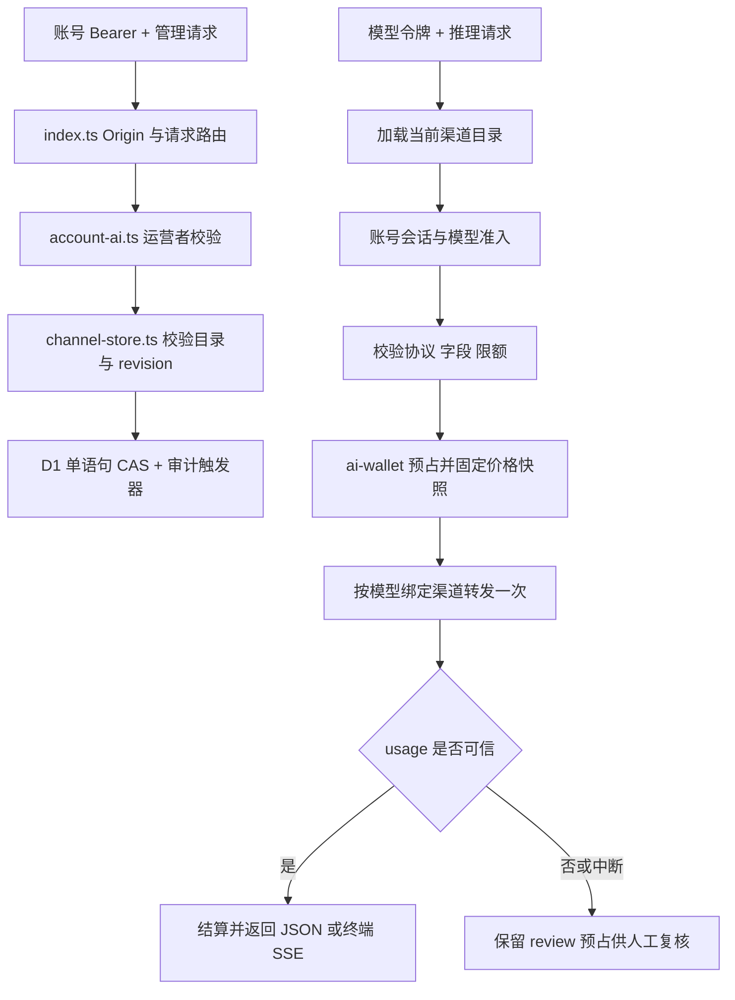

# 后端开发与维护交接指南

## 先读什么

1. 本文：建立后端结构、运行与维护概念。
2. [客户端 API 统一入口](gateway-client-api.md)：桌面/手机具体怎么调用。
3. [渠道与模型](gateway-channels.md)：配置持久化、加密、模型路由与热生效。
4. [生产部署记录](gateway-deployment-193.md)：实际服务器、部署 SHA、验证证据与限制。
5. [架构](architecture.md)：网关与桌面本地服务的数据边界。

本文对应后端分支 `backend/gateway-deploy-admin-193`。仓库远端 `personal` 指向 `fuhao009/OpenMausBot`；`origin` 是上游项目，不能把本项目改动默认推往上游。已部署功能提交 `64b453286`，文档更新提交与功能部署不是一回事。

## 这套后端是什么

`gateway/` 是账号、安装归属、模型访问权限、积分账本、模型路由和手机中继的服务端。`desktop/server/` 是用户电脑上的 bot、对话、工作区和工具执行服务，属于另一层。手机通过网关中继操作所属桌面；部署网关不会把桌面数据库搬到服务器。

网关有两种宿主：Cloudflare Worker 和本地 Node/Miniflare HTTPS 服务。生产 `192.168.66.193` 使用后者，两者共享 `gateway/control-plane/src` 和 SQL migrations。不能把 Miniflare 当作只用于测试的假后端；这里它承载真实 Worker/D1 业务路径。

## 代码地图

| 文件/目录 | 职责 | 修改时注意 |
| --- | --- | --- |
| `gateway/control-plane/src/index.ts` | HTTP 路由、Origin/CORS、安全响应、定时任务入口 | 新路由必须接入鉴权、请求体限额和错误契约 |
| `auth.ts`、`config.ts`、`http.ts` | Better Auth、认证配置、限额与响应安全头 | 不降低密码/TLS/来源校验；签名 Bearer 不等于 JSON 原始 token |
| `account-ai.ts` | AI 状态、模型令牌、运营者权限、积分/结算/渠道 API 分发 | 权限来自服务端 allowlist，不能由客户端声明 |
| `ai-config.ts` | 旧单上游配置解析、模型校验、公开模型投影 | 公开模型不能泄漏上游名、URL 或 key |
| `channel-store.ts` | D1 渠道目录、加密密钥、版本保存、模型发现、运行时路由配置 | 保存原子性、URL 换 key、读取错误不能回退启用旧配置 |
| `ai-gateway.ts` | Chat/Responses 校验、预占、单次转发、SSE/JSON 结算 | 失败不等于未计费，不能透明重试或自动退款 |
| `ai-wallet.ts` | 整数积分、预占、结算、调整、流水 | 金额安全整数/BigInt；历史价格快照不可重算 |
| `installations.ts` | 桌面安装注册、归属、凭据轮换/撤销 | 账号、安装、模型凭据不能互换 |
| `endpoints.ts`、`push.ts`、`highlevel.ts` | 可选托管隧道、APNS、HighLevel OAuth | 配置能力与账号登录独立，不能把未配置当已支持 |
| `admin-assets.ts`、`admin-html.ts`、`admin-script.ts`、`admin-style.ts` | `/admin` 静态界面与账号/结算交互 | Worker 直接打包字符串资产，无额外前端构建服务 |
| `admin-channel-html.ts`、`admin-channel-script.ts` | 渠道与模型表单 | 表单→暂存→填写原因→版本化保存；不回显 key |
| `gateway/control-plane/migrations/` | Worker/D1 schema | 历史 SQL 不改，新建递增 migration |
| `gateway/control-plane/test/` | 真实 workerd/D1 隔离测试 | 使用现有 env/setup，不能调用生产 |
| `gateway/local/local-gateway.mjs` | CLI、bundle、迁移、运行时、定时任务 | 启动先迁移，后开放监听；运营者名单不依赖是否已配置 AI |
| `gateway/local/local-gateway/` | TLS/config 私有文件、邮件、手机中继、macOS service | Linux 生产由 systemd 启动，不是 macOS service install |
| `scripts/verify-gateway-admin.mjs` | 一次性真实网关 + 假上游验证 | 临时账号/密钥/DB，结束清理，不读生产配置 |
| `packages/shared/product-account.ts` | 客户端公共类型 | 变更前协调客户端；类型里有名字不代表网关已实现同名 HTTP 路由 |

当前网关源码还引用 `desktop/electron/companion-relay-frames.mjs`、`control-plane-client.mjs`、`product-ca.mjs` 和 `scripts/product-fixture/runtime.mjs`。不能只复制 `gateway/` 就假定可运行；部署要保留这些路径和依赖。

## 两条核心请求链



渠道保存不重启服务，新请求加载新目录；已经发出的请求继续使用本次读到的配置与预占价格。所有启用渠道不代表自动负载均衡，每个公开模型只有一个明确渠道。

## 数据与秘密

- 用户/会话、安装、AI 令牌摘要、账本和请求都在 D1。
- `0012_account_ai.sql`、`0013_account_ai_points.sql` 管理账本约束；不要绕开触发器直接改余额。
- `0014_ai_channels.sql` 增加单行 `ai_channel_catalog` 和 `ai_channel_audit`；CAS 更新 revision，审计触发器与更新同事务。
- 渠道 key AES-GCM 加密，HKDF 从 `BETTER_AUTH_SECRET` 域分离派生密钥；AAD 绑定渠道 ID 与 canonical base URL。
- GET 管理目录仅返回 `hasKey`。密钥留空仅允许同渠道 ID、同 URL 保留；改 URL 需重新提供。
- 未保存渠道目录时读取旧部署环境变量；首次保存后 DB 唯一权威，空目录仍是明确关闭，不回退。
- `operatorIds`/`AI_OPERATOR_USER_IDS` 仍由服务器配置控制，网页不能加管理员。
- 备份必须保存完整 state 与 secrets/config。只留 DB、不留认证秘密，会丢失渠道解密能力；随意更换认证秘密还会影响登录会话。
- 用户输入“原因”也不要包含凭据。代码拒绝已知 key 出现在公开目录/原因中，但这不是任意秘密识别器。

## 本地开发

要求 Node >=24、pnpm（仓库声明 `pnpm@10.33.0`）。本机 `~/.local/bin/node` 是坏链接，先修正当前 shell PATH，不改其他开发者全局配置：

```sh
export PATH="$HOME/.local/nodejs/node-v24.16.0-darwin-arm64/bin:$PATH"
node --version
pnpm install --frozen-lockfile
```

若你位于其他平台，使用对应 Node 24 安装路径，不复制 macOS 路径。独立 worktree：

```sh
git fetch personal backend/gateway-deploy-admin-193
git worktree add ../HezuoBot-backend-local -b backend/my-change personal/backend/gateway-deploy-admin-193
```

### 启动可操作的隔离后台

```sh
unset HTTP_PROXY HTTPS_PROXY ALL_PROXY http_proxy https_proxy all_proxy
export NO_PROXY='127.0.0.1,localhost,::1'
node scripts/verify-gateway-admin.mjs
```

脚本打印临时 `/admin` 地址、证书路径、运营者/普通账号和假上游参数，使用独立临时 home/data。启动时证明无模型也能授权管理员，然后发布假上游、重启验证持久化，并生成一笔待复核请求。用这些临时参数验证页面，不能把它们复制到生产。Ctrl-C 正常关闭并清理。测试证书只信任在一次性测试配置内；生产永远校验证书。

非交互端到端验证：

```sh
node scripts/verify-gateway-admin.mjs --smoke
```

覆盖渠道发布、发现、实际假上游推理、重启与加密凭据读取。该脚本目前依赖 POSIX 进程组，Windows 开发者在 Linux/WSL 环境运行。

### 检查命令

```sh
pnpm exec tsc --noEmit -p gateway/control-plane/tsconfig.json
pnpm --dir gateway/control-plane exec vitest run \
  test/admin.test.ts test/account-ai.test.ts \
  test/channel-management.test.ts test/ai-gateway.test.ts
```

修改哪个领域就选覆盖该领域的测试。不要用整仓已知失败的 typecheck/lint 替代后端专项检查；也不要仅做源码匹配或静态页面检查就声称功能可用。页面变化必须打开真实隔离页面验证，包含 390px 窄屏、401/403、错误和成功状态。通用服务器/对话验证规范见 [verification/README.md](verification/README.md)。

### 已知运行时细节

- Cloudflare workerd fetch 只支持 `follow`/`manual`，不支持 `redirect: error`。渠道发现使用 `manual` 并拒绝非 2xx，不泄漏 key 到重定向目标。
- 发现模型有显式 10 秒 deadline，不能只依赖一个未必被宿主传递的 AbortSignal。
- 账号只有 `set-auth-token` 中签名 Bearer 可用于客户端；不要拿 JSON `token` 字段代替。
- 关闭/未配置托管 Cloudflare endpoint 的隔离环境，定时任务可能输出 `managed endpoint cleanup sweep failed ... misconfigured`；这不等于账号/渠道失败，也不能因此说隧道配置完整。
- CLI `status.capabilities` 是启动元数据，网页热更新后应查询运营者/账号 API 看当前模型能力。

## 生产部署维护

实际服务：`hezuo-gateway.service`，用户 `hezuo-gateway`，源码 `/opt/hezuo-gateway/app`，数据 `/var/lib/hezuo-gateway`，专用 Node `/opt/hezuo-gateway/runtime/node_modules/node/bin/node`。未替换机器上系统 Node、nginx 或其他业务。

```sh
ssh root@192.168.66.193 'systemctl status hezuo-gateway --no-pager'
ssh root@192.168.66.193 'journalctl -u hezuo-gateway -n 100 --no-pager'
```

发布顺序：

1. 在独立 worktree 完成代码、隔离测试和实际 UI 验证；提交并记录准确 SHA。
2. 计划短暂维护窗口，停止 systemd 后，完整备份数据（包括 state/WAL、secrets、TLS、config）及待替换源码，备份 root 私有。
3. 同步已验证源码和新增 migrations，不同步本机 `node_modules`、数据或凭据。新增依赖需要在服务器对应项目按锁定版本安装；现有部署使用独立 runtime 和 Linux 依赖。
4. 启动 systemd；启动会先应用 migrations，再开放监听。检查 `status` 的 migrations pending=0、健康与 `/admin`。
5. 通过可信 CA 检查真实服务；只读查看管理员和渠道能力。不向生产注入测试积分、测试用户/上游；任何真实账号创建需用户授权。
6. 成功后更新 `/opt/hezuo-gateway/deployed-commit` 与 Git 中的部署记录，再推送交接提交。不要在验证失败时写成已成功部署。

回滚先停服，再评估数据兼容性：代码回滚不自动撤销 SQL migration。需要恢复备份时恢复完整数据与配套秘密，不能仅回滚余额表或覆盖运行中的数据库。备份时点后新增用户/账本会丢失，必须先确认维护窗口和恢复方案。

当前 root 私有初始管理员凭据文件位置在部署文档中；密码不写入开发文档。开发者通常使用自己的隔离账号，不共享生产管理员密码。

## 开发协作规则

- 后端负责 `gateway/`、相关验证脚本和协议文档；桌面/手机由各端维护。不要顺手改变客户端配置或 UI。
- 先写/更新请求和响应契约，再实现。公共字段、错误码或认证方式变化必须说明兼容性，客户端通过 Git 获取，不靠聊天口头通知。
- 共享类型修改需要明确受影响端。现有公开模型结构没有渠道 URL/key，不能为了调试加进去。
- 每次小提交保持可验收，推送 `personal` 对应分支。部署 SHA、验证证据、未完成边界一起记入交接文档。
- 新迁移递增、可在旧库应用；禁改已运行的历史 migration。新配置保存必须考虑并发冲突、删除引用、重启持久化和未知网络结果。
- 钱包相关改动必须证明不重复扣费/退款、用量缺失转 review、历史价格不被新配置改变。

## 当前明确边界

已有账号/积分/人工结算、渠道/模型/只写 key、动态路由。尚无全局用户列表、设备管理后台、自动故障切换、Anthropic/Gemini 转换或订阅凭据发现。生产真实渠道仍需运营者填写；邮件/APNS/Cloudflare 托管端点并非已配置。后续需求必须真实实现后再标记可用，不增加空按钮或假统计。
