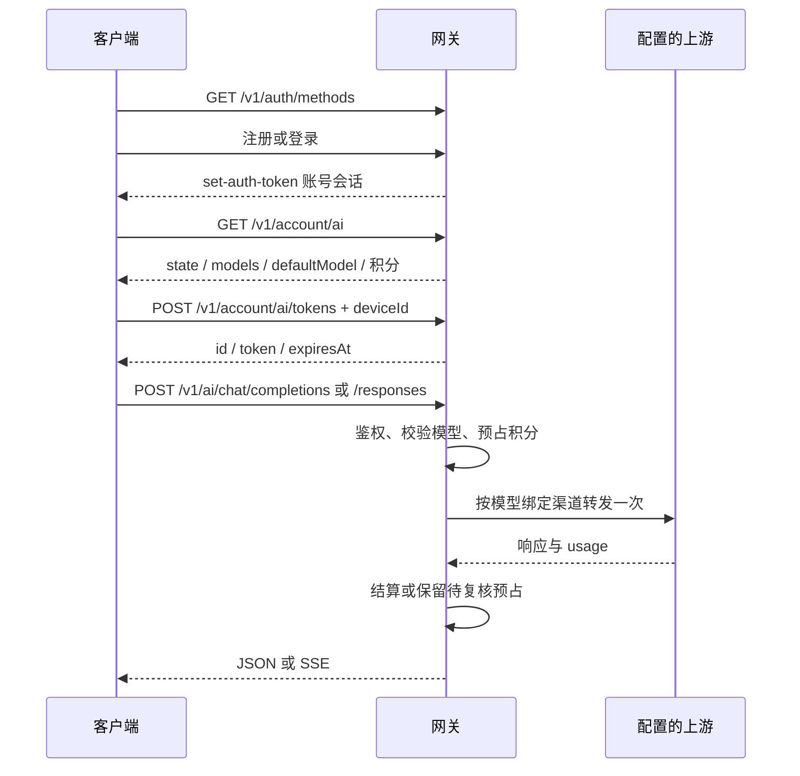

# 客户端接入网关 API：统一入口

面向桌面端、Android、iOS 开发者。本文描述 `gateway/` 网关对客户端开放的协议，不是桌面本地 `desktop/server` 的完整业务 API。手机访问 bot、对话、工作区的 API 经中继到所属桌面，不能把网关当作云端对话数据库。

## Git 与部署

- 任务计费分支：`backend/task-aware-billing`，基于 `backend/gateway-v1-lan`；远端 `personal`（`github.com/fuhao009/OpenMausBot`）。
- 实际部署提交、迁移与生产启用状态以 [部署记录](gateway-deployment-193.md) 为准；文档或隔离测试通过不代表生产已开启任务计费。
- 联调 base：`https://192.168.66.193:18487`；仅内网可达，不是公网地址。
- 注册账号不自动获得 AI 权限、积分或管理员权限。真实上游未配置时，不能用健康接口 200 宣称模型可用。
- 客户端只提交公开模型 ID，不持有渠道上游 key，不修改渠道配置。

```sh
git fetch personal backend/task-aware-billing
```

不要在其他开发者的工作目录切分支；使用独立 clone/worktree。客户端无需整体合并后端，只需对齐本文协议及必要共享类型。

## 按任务阅读

| 接入任务 | 调用说明 |
| --- | --- |
| 注册、密码登录、验证码、重置密码、退出、账号信息 | [认证 API](gateway-client-auth.md) |
| 查询账号 AI 状态、模型令牌、Chat/Responses、积分流水 | 本文下方 |
| 桌面注册、设备列表、凭据轮换、手机 HTTP/WebSocket 中继 | [设备与中继 API](gateway-client-devices.md) |
| 可选 Cloudflare 托管端点、APNS 推送 | [设备与中继 API](gateway-client-devices.md) |
| 可选 HighLevel OAuth | [认证 API](gateway-client-auth.md) |
| 管理员身份、开通、充值、人工结算 | [管理 API](gateway-admin-api.md)，普通客户端不得调用 |
| 渠道、上游密钥、模型定价管理 | [渠道 API](gateway-channels.md)，仅运营者 |

## 传输与三类凭据

所有 JSON 请求发送 `Content-Type: application/json`。标准 API 时间字段 `expiresAt`/`createdAt` 等以对应接口为准；本文账号 AI 接口为 Unix 毫秒。响应 `cache-control: no-store`，错误排查保存 `x-request-id`，不要记录 token、密码、prompt 或完整账号邮箱。

| 凭据 | 获取位置 | 用途 |
| --- | --- | --- |
| 账号会话 Bearer | 认证响应头 `set-auth-token`，签名后的原值 | `/v1/me`、账号 AI、安装管理、手机中继 |
| 模型令牌 | `POST /v1/account/ai/tokens` 返回 `token` | `/v1/ai/models`、`/v1/ai/quote`、Chat/Responses；15 分钟 |
| 安装凭据 | 创建/轮换桌面安装的响应 | `/v1/installations/self`、桌面中继隧道、端点与推送；90 天 |

三者不可互换。上游 API key 不是任何客户端凭据。桌面安全进程和手机安全存储持有会话；不要把会话/model token 传入不可信 renderer、URL query、日志或 Git。客户端传 UUID `deviceId`，每台设备稳定保存，不要每次请求生成新设备身份。

### TLS

证书位于服务器 `/var/lib/hezuo-gateway/tls/gateway-cert.pem`。通过可信 SSH 取得并核对，将其加入应用针对该 origin 的信任链；不能关闭 TLS 验证。手机的 `127.0.0.1` 是手机自己，不能填电脑回环地址。

以下 curl 示例假定调用者已通过安全方式设置环境变量，不包含真实凭据。`$CA` 为证书路径；公开 CA 证书部署可去掉 `--cacert`。不要用 `-k`。

```sh
export BASE='https://192.168.66.193:18487'
export CA='/absolute/path/gateway-cert.pem'
curl --cacert "$CA" "$BASE/healthz"
```

期望 `200 {"ok":true,"service":"openmausbot-control-plane"}`，也可能有容量信息。该 service 值是已有协议标识，不能替换成产品显示名。单凭此响应无法证明账号、桌面在线或上游推理。

## 推荐调用顺序



## 账号 AI 状态

`GET /v1/account/ai`，账号 Bearer，200。

```sh
curl --cacert "$CA" "$BASE/v1/account/ai" -H "Authorization: Bearer $ACCOUNT_TOKEN"
```

已配置、已授权且余额足够的示例（模型 ID/价格仅为说明，实际以响应为准）：

```json
{
  "state": "ready",
  "unit": "points",
  "availableMicroPoints": 5000000,
  "reservedMicroPoints": 0,
  "defaultModel": "team-chat",
  "models": [{
    "id": "team-chat", "label": "团队模型", "protocol": "chat",
    "pricingVersion": "v1", "inputMicroPointsPerMillion": 2000000,
    "cachedInputMicroPointsPerMillion": 500000, "outputMicroPointsPerMillion": 4000000,
    "maxContextTokens": 1000, "maxOutputTokens": 100
  }]
}
```

| state | 客户端行为 |
| --- | --- |
| `pending` | 尚未开通，提示联系管理员；不尝试推理 |
| `suspended` | 已被停用，停止续签与发送 |
| `unavailable` | 网关没有可用默认模型/上游配置，显示不可用 |
| `insufficient_balance` | 可用余额为零且无免费模型；展示余额并提示联系管理员 |
| `ready` | 可申请模型令牌；不要求余额覆盖整个模型上下文，具体请求仍独立验证实际预占及并发限额 |

上述状态有优先级：pending → suspended → unavailable → insufficient_balance → ready。前面三种通常 `models: []`、`defaultModel: null`。`insufficient_balance` 可包含模型目录。金额为整数微积分，1 积分 = 1,000,000 微积分；避免浮点累计。

## 申请、续签与撤销模型令牌

`POST /v1/account/ai/tokens`，账号 Bearer。请求严格为 `{deviceId: UUID}`。

```sh
curl --cacert "$CA" "$BASE/v1/account/ai/tokens" \
  -H "Authorization: Bearer $ACCOUNT_TOKEN" -H 'Content-Type: application/json' \
  --data '{"deviceId":"11111111-1111-4111-8111-111111111111"}'
```

成功 201：
```json
{"id":"22222222-2222-4222-8222-222222222222","token":"<opaque-model-token>","expiresAt":1794480000000}
```

保存 `id` 用于撤销，`token` 用于推理，按 `expiresAt` 提前续签。每台设备最多保留两个活跃令牌，便于交接；每个账号最多十台设备。重复申请不是无限增加凭据；达到限制可能返回 409 `token_limit_reached`。会话退出、令牌到期/撤销或账号停用使模型令牌失效。

`DELETE /v1/account/ai/tokens/:id`，账号 Bearer；本人已有令牌返回 204（无 JSON body），重复撤销仍为 204；未知/他人 ID 或非法 ID 返回 404。

```sh
curl --cacert "$CA" -X DELETE "$BASE/v1/account/ai/tokens/$MODEL_TOKEN_ID" \
  -H "Authorization: Bearer $ACCOUNT_TOKEN"
```

## 模型列表

`GET /v1/ai/models` 使用模型令牌，不使用账号 Bearer，不扣积分。

```sh
curl --cacert "$CA" "$BASE/v1/ai/models" -H "Authorization: Bearer $MODEL_TOKEN"
```

```json
{"object":"list","data":[{"created":0,"id":"team-chat","object":"model","owned_by":"hezuo"}]}
```

列表不包含价格和协议；用 `/v1/account/ai` 的 `models` 选择匹配端点的模型。渠道/模型停用会使新请求不可用；客户端不得缓存为永久能力。

## Chat Completions

`POST /v1/ai/chat/completions`，模型令牌，选择 `protocol: "chat"` 的公开 ID。

```sh
curl --cacert "$CA" "$BASE/v1/ai/chat/completions" \
  -H "Authorization: Bearer $MODEL_TOKEN" -H 'Content-Type: application/json' \
  --data '{"model":"team-chat","messages":[{"role":"user","content":"你好"}],"max_tokens":64,"stream":false}'
```

非流式成功 200，兼容上游 Chat completion JSON，模型名按网关公开映射处理。`choices`、工具调用、`usage` 随模型能力变化，不能把文档示例当固定输出。

允许顶层字段：`model,messages,tools,tool_choice,parallel_tool_calls,stream,stream_options,max_tokens,max_completion_tokens,temperature,top_p,stop,seed,presence_penalty,frequency_penalty,response_format,reasoning_effort,n,service_tier,billing`。未知字段拒绝；`messages` 必须非空；`n` 仅能为 1；两个 max 字段不能同时提供；输出上限为正整数并被服务器模型上限限制。仅支持 `type:function` 工具，不执行工具本身。`service_tier` 和 `billing` 规则见下方任务计费契约。

### SSE

```sh
curl --no-buffer --cacert "$CA" "$BASE/v1/ai/chat/completions" \
  -H "Authorization: Bearer $MODEL_TOKEN" -H 'Content-Type: application/json' \
  --data '{"model":"team-chat","messages":[{"role":"user","content":"你好"}],"max_tokens":64,"stream":true}'
```

使用 POST fetch/原生网络流读取 SSE，不能直接用只支持 GET 且无法设置 Bearer 的浏览器 EventSource。增量 UTF-8 解码，按空行切事件，处理 CR/LF、跨 chunk 的 `data:` 和 JSON；Chat 通常以 `[DONE]` 终止。服务器请求终端 usage 后结算；HTTP 200 后仍可能出现 `event: error` 或中断，不能只看初始状态判成功。停止请求应取消网络流，但取消不等于免费或自动退款。

## Responses

`POST /v1/ai/responses`，模型令牌，选择 `protocol: "responses"` 的公开 ID。

```sh
curl --cacert "$CA" "$BASE/v1/ai/responses" \
  -H "Authorization: Bearer $MODEL_TOKEN" -H 'Content-Type: application/json' \
  --data '{"model":"team-responses","input":"你好","max_output_tokens":64,"store":false,"stream":false}'
```

允许顶层字段：`model,input,instructions,tools,tool_choice,parallel_tool_calls,stream,max_output_tokens,temperature,top_p,reasoning,text,include,store,background,service_tier,billing`。`input` 为非空字符串或非空数组；`store`/`background` 只能省略或 false；`include` 仅接受 `reasoning.encrypted_content`；工具仅 function。不支持服务器远端存储、后台运行、`previous_response_id` 等未列出字段。流式设置 `stream:true`，按 Responses 事件处理 `response.completed`、`response.incomplete`、`response.failed` 及 `event:error`，不是只等 Chat 的 `[DONE]`。`service_tier` 和 `billing` 规则见下方任务计费契约。

两种推理端点不自动互相转换；选错协议返回 403 `model_not_allowed`。请求体最大 48 MiB；上游单次交换超时 300 秒。服务端只转发一次，不保证失败代表上游未计费。

## 任务计费报价与预算

任务计费需要运营者显式开启、配置模型能力档案和已知采购费率。客户端只在最新模型目录出现时使用 `auto-chat` / `auto-responses`，分别发送至匹配协议的端点；不在客户端硬编码可用性。自动模型目录中的单价仅为目录展示提示，不是本次任务承诺价。

服务端用输入规模、轮次、工具、图片、推理要求和任务标记作结构启发式评估，返回 `simple|standard|complex` 及原因；不宣称准确理解任务难度。满足档位、协议、上下文及工具/图像能力后，按估算费用选模型。显式模型 ID 不会被替换；未配置任务档案或没有采购价的显式模型保留原固定积分计费。无可用模型直接拒绝，不自动跨协议、跨模型重放。

### 报价

`POST /v1/ai/quote`，模型令牌，请求体仅含 `endpoint: "chat"|"responses"` 与完整推理 `request`：

```sh
curl --cacert "$CA" "$BASE/v1/ai/quote" \
  -H "Authorization: Bearer $MODEL_TOKEN" -H 'Content-Type: application/json' \
  --data '{"endpoint":"responses","request":{"model":"auto-responses","input":"你好","max_output_tokens":64}}'
```

成功返回以下字段：

| 字段 | 含义 |
| --- | --- |
| `selectedModel` | 本次报价选择的公开实际模型 ID |
| `complexity,score,reasons` | 结构启发式评估结果；不含原始 prompt |
| `estimatedInputTokens` | 本地保守文本估计，不是模型 tokenizer 或供应商 usage |
| `estimatedMicroPoints` | 估计输入及请求输出上限对应费用，不是最终扣费或硬上限 |
| `reservedMicroPoints` | 文本输入按 `min(剩余上下文, ceil(estimatedInputTokens × 1.5) + 2048)` 预占，图片输入按全部剩余上下文预占；再计入请求输出上限 |
| `policyRevision` | 报价读取的运营策略版本；不单独锁住控制器倍率 |
| `currency,pointsPerCurrency` | USD 与积分估值关系，不是现金兑换 |
| `rateSnapshot` | 输入、缓存输入、输出的整数微积分/百万 token 展示费率；不含采购成本 |
| `noPriceCommitment` | 恒为 true：报价不承诺后续请求价格 |

报价不发上游请求、不预占、不扣积分、不创建推理账本 ID，也不持久化 prompt。实际请求重新评估并在准入时锁定策略、费率、模型、渠道、服务档位、时间条件与预占；之后不追溯改价。必须通过下面的预算上限约束用户授权，不能将报价 token 数或三项展示费率重新计算为权威价格。

### 预算与服务档位

两种推理请求均可携带网关字段 `billing: {"maxMicroPoints": 1000000}`；值为非负安全整数微积分。服务端将**实际预占额**与预算比较，超出返回 402 `budget_exceeded`，不预占、不调用上游。该字段不会转发给上游，也可约束原固定计费模型。它仅限制准入预占，**不是最终扣费硬上限**：可信实际用量超过预占时，会在同一事务中补扣可用余额；余额不足时收取预占与全部可用余额，并进入 `review`，原始用量完整保留。客户端不得把该字段展示为最终花费上限。

`service_tier` 仅在该请求采用任务计费时允许：默认省略；已支持的 GPT 费率可选择 `default|priority|fast|ultrafast`，但具体模型必须有对应费率（例如 Luna 不支持 ultrafast）。非 GPT 采购表只接受 default。独立 `-ultrafast` 模型已包含快速档倍率，不会重复加倍。无对应费率或非字符串档位返回 400 `invalid_request`，不会当免费、猜测价格或静默降级。

正常分发返回 `x-ai-model`（实际公开模型）和 `x-ai-pricing-version`，以及原 `x-ai-request-id`；网络异常响应可能只有账本 ID。JSON/SSE 的模型映射仍使用公开 ID。最终费用以账号流水为准，预占不是收入；usage 缺失或不合法、缓存写入费率缺失、用量越界仍可能进入 review。运营者成本和毛利只在管理 API 返回，不向普通客户端公开。

客户端中途断开后，网关继续读取上游，最多等待 120 秒。拿到可信用量后按实际费用结算（`client_disconnected_settled`）；超时或上游出错仍进入复核（`client_disconnected`）。进程退出无法保证后台读取继续，遗留请求仍由陈旧预占恢复处理。超过预占且余额不足的复核原因为 `usage_exceeds_reservation`，此时余额预占已归零，历史请求预占字段仍保留准入金额。

文本 token 数按脚本类别作近似估计（ASCII 每四字符约一个 token，非 ASCII 按字符类别增加权重），包含工具定义和 instructions；不是供应商 tokenizer。上游注入的上下文可能使实际输入高于估计，动态计费同样按可信 usage 补扣。193 的本地 HTTPS 前端通过可信 dispatch 元数据和私有 service binding 传递断线事件，并继续读取 Worker 响应；不取消 Miniflare 的响应传输。

报价仅对采用任务计费的请求有效；显式模型没有启用该路径时返回 503 `dynamic_billing_disabled`。未发布的自动 ID、能力/上下文不匹配、档位不支持应刷新目录或修改请求，不透明重试。任务计费关闭时不要继续发送缓存的自动 ID。


## 账号积分流水

`GET /v1/account/ai/ledger?cursor=…`，账号 Bearer；首次省略 cursor，后续原样传服务端 `nextCursor`（URL 编码），null 表示结束。

```sh
curl --cacert "$CA" --get "$BASE/v1/account/ai/ledger" \
  -H "Authorization: Bearer $ACCOUNT_TOKEN" --data-urlencode "cursor=$NEXT_CURSOR"
```

```json
{"items":[],"nextCursor":null}
```

每项有 `id,kind,createdAt`。`kind` 为 `request|enable|disable|grant|settle`；可选字段 `model,state,amountMicroPoints,reservedMicroPoints,chargedMicroPoints,inputTokens,cachedInputTokens,outputTokens,reason`，不要把缺失用量当 0。请求状态 `reserved|streaming|review|settled`；review 表示计费结果不确定，不能自动退款或重复发送。完整类型见 [`ProductLedgerPage`](../packages/shared/product-account.ts)。

## 错误与重试

普通账号/管理 API 常见包络 `{ "error": "code" }`；推理 API 包络 `{ "error": { "code": "…", "type": "…", "message": "…" } }`。两者需分别解析。

`x-request-id` 标识 HTTP 请求；`x-ai-request-id` 标识账本中的推理请求行。只有预占成功后才带 `x-ai-request-id`，包括成功、拒绝释放、待复核及 SSE；鉴权/校验/余额/并发准入失败不带。客户端详情保留两个 ID，运营者用后者关联账本。

| HTTP / code | 客户端处理 |
| --- | --- |
| 401 `unauthorized` | 账号会话失效，重新登录 |
| 401 `ai_token_invalid` | 模型令牌失效；检查账号会话并续签，不盲目重放已发送推理 |
| 403 `ai_not_enabled` / `ai_suspended` | 联系管理员，停止自动请求 |
| 403 `model_not_allowed` | 刷新账号模型目录，检查协议、模型或渠道是否停用 |
| 402 `insufficient_balance` | 显示余额/预占，停止自动重试 |
| 402 `budget_exceeded` | 预占上限超过用户授权预算；重新报价或调整输出/模型，由用户决定是否提高预算 |
| 429 `ai_busy` | 账号并发已满，尚未预占；固定 `Retry-After: 2`，可排队等待再发送 |
| 503 `ai_temporarily_busy` | 上游 429，按内测策略释放预占，用户积分未扣；稍后可以重新发送 |
| 503 `ai_temporarily_unavailable` | 指定上游拒绝状态按内测策略释放预占，用户积分未扣；服务恢复后可以重新发送 |
| 503 `ai_unavailable` | 配置/运行时不可用，不假装模型正常 |
| 503 `dynamic_billing_disabled` | 报价请求没有使用任务计费；刷新能力，保留显式模型原调用路径 |
| 400 `invalid_request` | 修正字段，不重试相同错误请求 |
| 413 `request_too_large` | 缩小请求，48 MiB 上限 |
| 502 `upstream_error` / 流中断 | 结果可能已计费，刷新流水并提示复核，禁止透明重放 |

模型推理没有通用 `operationId` 幂等协议。管理员充值的幂等 UUID 不能套用于 Chat/Responses。对请求结果未知的自动重试会产生新的预占和上游调用。

释放策略仅针对完整拒绝响应的 400/401/403/404/408/409/413/422/429 且没有可结算 usage；有 usage 仍按实际用量结算。此为运营方承担失败成本的策略，不证明上游未计费。5xx、重定向、压缩响应、读取中断、网络超时及流式 200 后失败仍保留 review；绝不自动重放。

## 联调交付清单

- 能力发现、密码登录、使用签名会话读取本人信息。
- 区分未开通、停用、未配置、余额不足与可用，不把注册成功当 AI 开通。
- 正确续签和撤销模型令牌；退出后旧令牌不可用。
- 按公开模型协议选择端点，处理 JSON/SSE、错误与取消，凭据不进入日志。
- 桌面注册/轮换，手机只查询所属安装并经中继访问；断线、离线和跨账号拒绝按设备文档处理。
- 提交问题时附客户端 SHA、后端部署 SHA、脱敏路径、HTTP/error code、时间和 request ID；不要附真实密码/token。

本文档不是“所有功能已在生产打通”的声明：生产模型、任务计费策略、邮件/APNS/Cloudflare 托管端点按部署能力启用。通过隔离 fixture 验证的范围详见部署记录；未对生产账号注入测试积分或发起测试推理。
